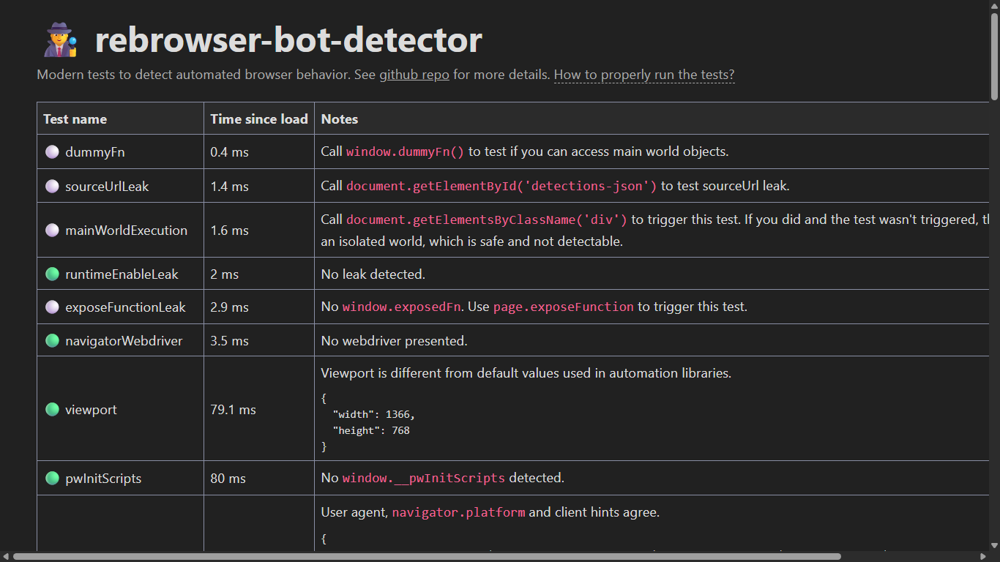
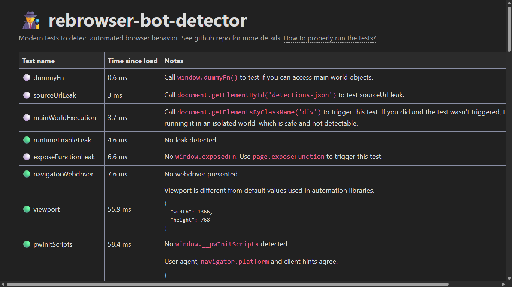
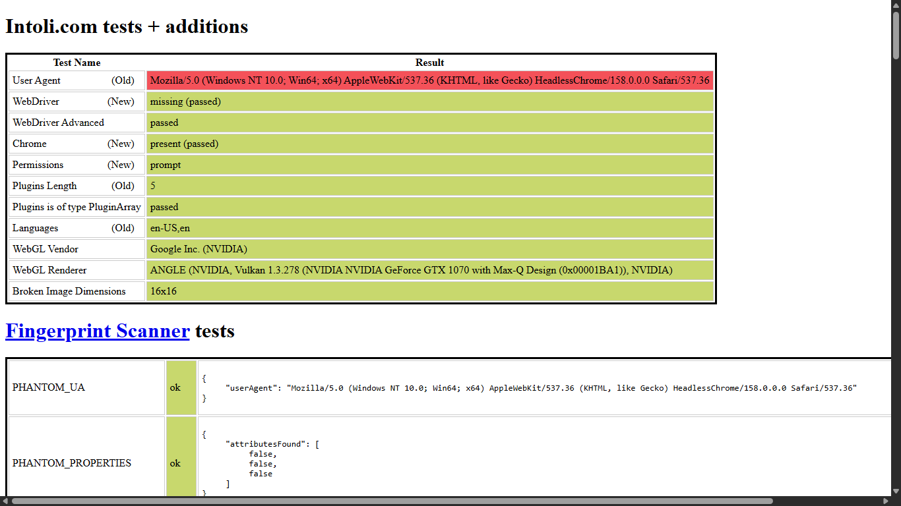
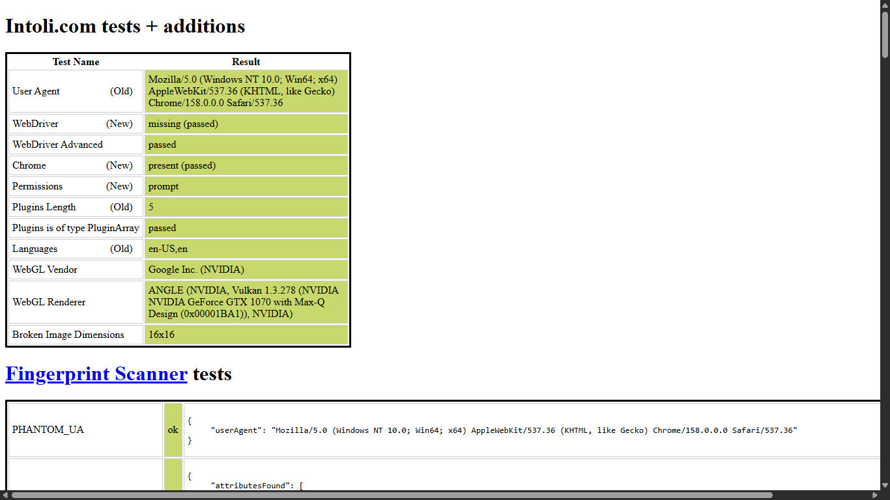

# Stealth: what happens by default

## Headless parity, measured (November 2026)

Measured against public bot detection pages and a probe page of our own, on a Windows 11 machine with a discrete GPU and Google Chrome 158 installed, through BrowserGlass's own client with nothing else attached. Before is main at 30443dc; after is the `stealth/patchright` branch.

What leaked: a headful BrowserGlass browser was already clean on every page. A headless one gave itself away in three ways. Its user agent and `navigator.appVersion` said `HeadlessChrome`. Its screen was Chrome's headless default of 800 by 600 under a 1366 by 768 page. And a spec that set `userAgent` without `clientHints` emptied `navigator.userAgentData`, because the override went out without metadata. A headful window was also sized to the viewport itself, so `outerWidth` was 1367 around a 1366 page: a window with no room for a toolbar.

What changed:

* `runtime-host/src/flags.ts`: a headless launch with no `userAgent` in its spec sends the user agent a headful Chrome of the same build sends (`headfulUserAgent`, from the resolved binary's version; Chrome's reduced agent has one fixed shape per desktop platform), and gets `--screen-info` with a common desktop screen that holds the window. A headful window with no size of its own holds the viewport plus Chrome's frame.
* `server/src/session/client-hints.ts` and the client hints hook in `factory.ts`: with `--user-agent` set, headless Chrome leaves the high entropy hints empty, so every page gets client hints that agree with the agent, built the way Chromium builds its brand list (the "Not A Brand" entry's spelling, version and place follow from the major version). The Chrome version comes from `Browser.getVersion` on the browser session. A spec with `userAgent` and no `clientHints` gets the same instead of an empty `userAgentData`. After the change the headless hints match a plain headful Chrome on the same machine field for field.
* `protocol/src/domain/arg-lists.ts`: `--use-fake-device-for-media-stream` and `--use-fake-ui-for-media-stream` are allowed in `extraArgs`, for tests that need a camera and microphone (a call between two browsers). Fake devices are visible by their labels, so a run that must look like a person grants a real device instead. `--use-file-for-fake-video-capture` stays refused: it reads a file off the host.

Scores (tells on the probe page; rebrowser bot-detector red and yellow tests; sannysoft rows failed; CreepJS headless, like headless and stealth percentages; BrowserScan's verdict; pixelscan items detected; fingerprint-scan.com bot score; deviceandbrowserinfo verdict; incolumitas FAIL count):

Before:

| mode | tells | rebrowser | sannysoft | creepjs | browserscan | pixelscan | fpscan | dabi | incolumitas |
|---|---|---|---|---|---|---|---|---|---|
| headed | 0 | 0 red, 0 yellow | 0 failed | 0% headless, 25% like, 0% stealth | Normal | 0 detected | 41/100 | human | 1 FAIL (WEBDRIVER) |
| headless | 3 | 2 red, 1 yellow (HeadlessChrome, headless) | 3 failed | 67% headless, 25% like, 0% stealth | Robot | 3 detected (Webdriver, HeadlessChrome, AdvancedBotDetection) | 100/100 | bot (hasBotUserAgent) | 4 FAIL (userAgent, HEADCHR_UA, WEBDRIVER, CHR_MEMORY) |

After:

| mode | tells | rebrowser | sannysoft | creepjs | browserscan | pixelscan | fpscan | dabi | incolumitas |
|---|---|---|---|---|---|---|---|---|---|
| headed | 0 | 0 red, 0 yellow | 0 failed | 0% headless, 25% like, 0% stealth | Normal | 0 detected | 41/100 | human | 1 FAIL (WEBDRIVER) |
| headless | 0 | 0 red, 0 yellow | 0 failed | 0% headless, 25% like, 0% stealth | Normal | 0 detected | 41/100 | human | 1 FAIL (WEBDRIVER) |

fingerprint-scan.com weighs the network and the address, which no browser change touches, so it stays where the headful run already was. incolumitas' `WEBDRIVER` test reads whether `navigator.webdriver` exists, which it does in every Chrome.

rebrowser bot-detector, headless, before and after:




sannysoft, headless, before and after:




What a driver on top can still give away: a client that turns on the Runtime domain (console diagnostics here, or a Playwright attach) shows up on rebrowser's `runtimeEnableLeak` and on pixelscan's CDP check, and a driver that evaluates with `userGesture: true` gives the page a user activation with no input behind it. The sections below on console diagnostics still apply. The headless window has no frame, so `outerWidth` equals `innerWidth`, as in any headless Chrome.


BrowserGlass does specific, measured things to reduce automation signals. This page is what, how it was verified, and what it deliberately does not do.

## What happens at every launch

Every browser launched by BrowserGlass gets these, regardless of stealth setting.

**`--disable-blink-features=AutomationControlled`.** This is Blink's own automation suppression flag, passed at every level. It stops the browser from emitting certain signals that a page can read; most notably, the value of `navigator.webdriver` becomes `false` (on real, non-automated Chrome it is `false` too). See `packages/runtime-host/src/flags.ts:205`.

**Evaluate can run in an isolated world.** `evaluateWith(script, args, { world: 'isolated' })` runs in a private world that shares the DOM and nothing else, so the page cannot see the script, hook what it calls or read what it leaves behind. The default is still `'main'`, for callers that read page globals; a caller that must not be seen passes `'isolated'`. See `EvaluateOptions.world` in `packages/automation/src/types.ts`.

**`Runtime.enable` is sent from one place.** The only module that sends `Runtime.enable` is `packages/core/src/diagnostics/target-diagnostics.ts:399`, verified by grepping the entire build. That call is conditional: it happens only when a viewer subscribes to console or error diagnostics. This is load-bearing for the stealth story below.

**On Windows the profile gets a Local State seed before Chrome starts.** See "Failed Windows logons" below.

### Failed Windows logons

Chrome on Windows checks at startup whether the signed in user's password is blank. It does that by calling LogonUser with an empty password, and each call is one failed logon for the account (Security event 4625, from chrome.exe). Chrome skips the check when the profile's `Local State` already holds an earlier answer. A fresh BrowserGlass profile has no `Local State`, so every start of the installed Chrome on one cost a failed logon. Ten in ten minutes is a common lockout policy, and one run of the runtime-host and conformance suites on a Windows test box locked its account for ten minutes, SSH included.

Writing only the answer keys does not work; Chrome asked again in testing. A whole `Local State` that Chrome wrote itself, after answering and after fetching its variations, is trusted. So each machine keeps one as its seed at `~/.browserglass/local-state-seed.json` (or `BGLS_LOCAL_STATE_SEED`), the same file GlassQA uses. `spawnDetachedChrome` copies it into the profile, or merges its answer into the `Local State` that is there, right before every Chrome start (`packages/runtime-host/src/local-state-seed.ts`). `BGLS_SEED_LOCAL_STATE=0` turns that off. The runtime never makes a seed on its own, because making one costs the very logon it saves.

The test suites that start Chrome (runtime-host, conformance, server) share one setup, `packages/runtime-host/test/support/seeded-chrome.ts`. On a Windows machine with no seed it makes one, once, with a single headless Chrome; that start is the one failed logon the machine pays. It points the temp folder of every test worker at one run folder and removes it, with any Chrome still running under it, when the run ends. Under the test runner, or with `BGLS_REQUIRE_SEEDED_PROFILE=1`, a Windows Chrome start on a profile that still has no answer throws `UnseededProfileError` instead of costing a logon.

Measured on 2026-11-27 with the account's bad password count (`net user <name>`, or ADSI `BadPasswordAttempts`), read before and after a full `pnpm install && build && lint && typecheck && pnpm -r test` and every 20 seconds during it. On two Windows test machines it was 0 before, 0 after and never rose during the run. Before this change the same suites locked one of those accounts. The run folder was gone afterwards and no new profile was left in either machine's temp folder.

---

## The tradeoff: console diagnostics make you visible

This is the one honest, measured decision every operator needs to know about.

**Console and error diagnostics cost liveness.** Subscribing to `diagnostics.subscribe` with `console: true` or `errors: true` causes the module above to send `Runtime.enable` to the browser. That call makes `Runtime` domain active, which produces `executionContextCreated` events and broadcasts every `console.log` the page makes as a `consoleAPICalled` event. A page can detect that activity: Chrome's debug protocol emits these as observable state changes, and a page that listens for them learns that a remote driver is present.

**Measured.** Against Chrome 152 (Windows, the machine the measurements were taken on):

- Five `Runtime.evaluate` calls with `Runtime` never enabled: zero `executionContextCreated` events, zero `consoleAPICalled` events.
- One `Runtime.enable` call: produces at least one `executionContextCreated` event.
- After that, 25 `console.log` calls: 25 observable `consoleAPICalled` events (one per call).

This is from `examples/nextjs-demo/diagnostics-fingerprint-probe.mjs`, run against the live gateway.

**Network diagnostics never touch `Runtime`.** You can debug network traffic, watch requests and responses, and stay inaudible. `fetchNetworking()` in `packages/core/src/diagnostics/target-diagnostics.ts` never sends `Runtime.enable`. It turns on the browser's own network instrumentation independently. This was already true in the earlier `applyFeeds` call; the probe above confirms it at the wire level.

**The caller can check before subscribing.** `diagnostics.status.get()` reports `fingerprintActive: true` or `false`, telling you whether this target is already known to be carrying the automation fingerprint. Every `diagnostics.subscribed` reply echoes the current state too. Call this before you subscribe to console, and you can decide whether to accept the visibility cost or skip the console logs.

**Per-request acknowledgement.** A stealth instance refuses console diagnostics with `E_DIAGNOSTICS_STEALTH_CONFLICT` unless the request carries `acknowledgeStealthRisk: true`. This is per request, not global: a second viewer needs to acknowledge the risk independently. It is not a warning, it is a brake: the server refuses the call unless you opt in, so you cannot accidentally enable it.

---

## The MEASURED_STEALTH_PROFILE

**What it is.** A `StealthProfile` registered at level `'full'` whose every claim was checked against a real, locally installed Chrome before being written. Measured on Chrome 152.0.7977.64 (Windows, via `binary-discovery.ts`).

**How to use it.** Register it when you create the host runtime:

```typescript
import { createHostRuntime, MEASURED_STEALTH_PROFILE } from '@browserglass/runtime-host';

const { runtime } = await createHostRuntime({
  nodeId: 'node-1',
  stealthProfiles: [MEASURED_STEALTH_PROFILE],
  enabledStealthLevels: ['off', 'full'],
  // ... stateDir, profileRoot, and the rest of HostRuntimeConfig
});
```

The `validatedChromeMajors` field records that this profile was verified against Chrome 152. If your Chrome updates to 153, the measurements may shift.

**The measurement method.** Three sources were compared against each other:

1. Real, non-automated Chrome: an everyday Chrome window a person already has open, read through page-JS evaluation that does not add any CDP or automation flags.
2. Stock automated: Chrome launched with nothing but basic flags (`--user-data-dir`, `--remote-debugging-port`, `--no-first-run`, `--no-default-browser-check`) and no automation-suppressing flags.
3. This runtime's own launch: Chrome with the exact flag set `flags.ts`'s `UNCONDITIONAL_BASE_FLAGS` produces, headful and headless, matching what `HostRuntime.doLaunch` actually runs.

Every check below cites which source found what. The measurements are from `packages/runtime-host/src/stealth-profiles/measured.ts`, the source of truth for this page.

---

## What it closes

**`navigator.webdriver` value.** Closed via `--disable-blink-features=AutomationControlled` (applied at launch to every browser, regardless of stealth level). A real Chrome's getter returns `false`. Stock automated Chrome's getter returns `true` (it now treats "remote debugging port open at all" as automation). This runtime's browsers return `false`, matching real Chrome.

**`navigator.userAgent` under headless.** Closed via `Emulation.setUserAgentOverride`. Measured on the Windows test machine:

- Headless stock automated: `Mozilla/5.0 ... HeadlessChrome/152.0.0.0 ...`
- Real Chrome (non-automated): `Mozilla/5.0 ... Chrome/152.0.0.0 ...`
- This runtime headless: `Mozilla/5.0 ... Chrome/152.0.0.0 ...` (the `HeadlessChrome` marker is removed)

The string `HeadlessChrome` in a User-Agent is one of the single most commonly checked automation signals. Leaving it would contradict shipping a stealth profile at all.

**`navigator.userAgentData` is not wiped.** When `setUserAgentOverride` is called with only `userAgent` set and no `userAgentMetadata`, Chrome silently wipes `navigator.userAgentData` to an empty object. This profile reads `userAgentData` BEFORE overriding the UA string and hands the metadata back in the same call, so nothing is lost. Measured: the values are already identical between headless and headful Chrome on the Windows test machine (brands, platform, mobile flags do not mention headless mode).

A gap here: on insecure origins (non-HTTPS, non-localhost), `navigator.userAgentData` is `undefined` (the Client Hints JS API's own secure-context gate). This profile has nothing to read back and sends no metadata in that case. Low-entropy headers may still reflect the absence on such pages.

---

## What it does not close, and why

**`navigator.plugins` and `navigator.mimeTypes`.** Measured identical across all three sources (5 plugins, 2 mime types) on this Chrome, headless and headful alike. Nothing to patch.

**`window.chrome`.** Measured identical across all three sources (`{app, csi, loadTimes}`). Nothing to patch.

**WebGL vendor and renderer strings.** Measured identical between headless and headful on the Windows test machine because it has a real GPU. On a GPU-less host (typical Linux CI), headless Chrome legitimately reports a software renderer (SwiftShader), whether or not it is automated. Spoofing a vendor string there would MANUFACTURE a fingerprint no real browser on that host produces. A patch must make the browser look MORE LIKE an unpatched Chrome, never merely different. Not implemented on principle.

**`outerWidth` equals `innerWidth` in headless.** Measured, and this is exactly what real, non-automated headless Chrome does too. There is no OS window frame in headless, so there is no difference to report. Not a tell; not touched.

**`Notification.permission`.** Measured `'denied'` across all three sources, including real Chrome on a fresh profile. Not automation-correlated on this Chrome.

**`navigator.plugins` revealing the automation flag itself.** Plugins and WebGL vendor strings are identical whether or not the flag is set, measured on this Chrome. Nothing is hidden inside them.

---

## What not to believe

**Undetectability.** This profile closes specific, named automation signals on a specific Chrome version. It does not defeat commercial bot-detection services. It does not make detection impossible. The tells that are NOT closed above are still visible to any code that looks for them.

**Universal coverage.** Chrome updates frequently. Every measurement above is from 152. Chrome 153, 154, and later may behave differently. If you are running this profile against a newer Chrome, rerun `runStealthSelfTest` (in `packages/runtime-host/src/stealth-self-test.ts`) to learn what changed. This is the honest way to keep `validatedChromeMajors` current.

**Protection against sophisticated detection.** A sufficiently motivated detector can watch the network stack, check for anomalous TLS/HTTP/2 fingerprints, correlate cookies and localStorage across visits, or instrument the user's OS. None of that is on this page because this profile does not touch any of it.

---

## The lesson

A patch must make the browser look MORE LIKE an unpatched Chrome, never merely different.

`BASIC_STEALTH_PROFILE` (kept in the tree as a reference implementation, not a recommended profile) patches `navigator.webdriver`'s getter in JavaScript to return `undefined`. The value is correct. The mechanism is wrong: a real browser's getter reads `"function get webdriver() { [native code] }"`, but after this profile's patch, it reads `"() => undefined"`. That is a strictly worse, newly-introduced tell that no real browser shows, measured directly on Chrome 152 after the patch runs.

`basic.ts`'s own justification (that `--disable-blink-features=AutomationControlled` removes the property entirely) was measured to be wrong on this Chrome. The property is present with a native getter in every source tested, including genuinely non-automated Chrome. The flag changes only the value the getter returns, not whether the property exists.

`MEASURED_STEALTH_PROFILE` does not patch the webdriver property at all. The flag produces the correct value via the native getter. Adding a JS patch on top would make it worse, not better.

Assert on shape, not value. When you write a stealth patch, check that the getter, the descriptor, and the prototype shape all match the real thing. A test that only checks the value cannot tell "correct" from "correct value, wrong mechanism".

---

## Stealth self-test

`runStealthSelfTest` in `packages/runtime-host/src/stealth-self-test.ts` validates a profile against a live Chrome. This is how `validatedChromeMajors` gets populated honestly.

Run it after a Chrome update:

```bash
cd packages/runtime-host
npx tsx src/stealth-self-test.ts
```

It launches a browser under the profile and checks every claim this page makes, reporting which Chrome version it tested and whether all checks passed. Add the major version to `validatedChromeMajors` in the profile itself if all checks pass.

See `examples/nextjs-demo/stealth-selftest-probe.mjs` for a probe that exercises this against the live gateway.

---

## Reading this if you are building a profile

Copy `MEASURED_STEALTH_PROFILE`'s shape, not `BASIC_STEALTH_PROFILE`'s. Implement `launchArgs`, `initScripts`, `onTargetAttached`, and `selfTest`. Test every patch against a real Chrome build before shipping. Record the major versions in `validatedChromeMajors`. When Chrome updates, rerun the self-test. Keep a changelog of what broke between Chrome versions so later operators understand why a patch was dropped or revised.

The tradeoff between console diagnostics and invisibility (the first section above) is baked into the core, not the profile. An operator configures whether to acknowledge the risk. A profile has no say in that.
